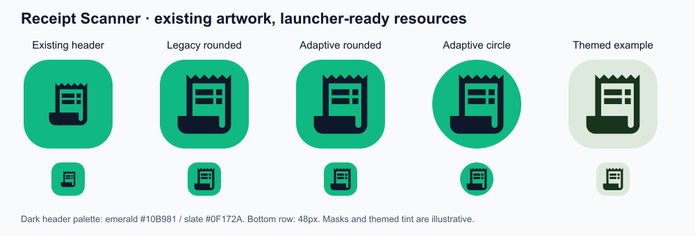

# Receipt Scanner launcher icon

The first preview is the existing dark-theme header. The others show the
launcher artwork at enlarged and 48px sizes; launcher masks and themed colors
are illustrative, not Samsung device screenshots.

## Existing artwork and colors

`TopAppBarSection.kt` renders `Icons.AutoMirrored.Filled.ReceiptLong` at 24dp,
centered in a 42dp box with 12dp corners. The box uses `primary`, and the icon
uses `onPrimary`. The requested dark-on-green appearance is the existing
`DarkColorScheme`: `EmeraldLight` (`#10B981`) and `Slate900` (`#0F172A`). The
light-theme header instead uses white on `EmeraldPrimary`; no UI/theme code has
been changed.

The launcher uses the exact five ReceiptLong paths from the app's resolved
AndroidX Material Icons 1.7.0 dependency, not a newly drawn receipt or a different
Material symbol. Source:
[official AndroidX source artifact](https://dl.google.com/dl/android/maven2/androidx/compose/material/material-icons-extended-android/1.7.0/material-icons-extended-android-1.7.0-sources.jar),
`androidx/compose/material/icons/automirrored/filled/ReceiptLong.kt`.
The vector files retain its AOSP copyright and Apache 2.0 notice.

The previous PNG/JPEG launcher assets had invalid file signatures containing
UTF-8 replacement bytes, so they could not be reused as valid image files.
Replace all legacy PNGs and remove the obsolete foreground JPEG.

## Resource changes

| Files | Purpose |
| --- | --- |
| `res/drawable/ic_launcher_foreground.xml` | Transparent 108dp receipt vector, dark slate |
| `res/drawable/ic_launcher_background.xml` | Full-bleed 108dp emerald background; launcher supplies adaptive mask |
| `res/drawable/ic_launcher_monochrome.xml` | Identical receipt geometry in black on transparency; Android supplies themed tint |
| `res/values/launcher_icon_colors.xml` | Fixed existing dark-header colors |
| `res/mipmap-anydpi-v26/ic_launcher.xml` and `ic_launcher_round.xml` | Adaptive layers, with explicit monochrome reference |
| `res/mipmap-{mdpi,hdpi,xhdpi,xxhdpi,xxxhdpi}/ic_launcher.png` and `ic_launcher_round.png` | Valid RGBA legacy icons at 48, 72, 96, 144, and 192px; rounded-square and circular backgrounds |
| `res/drawable/app_icon_fg_1791794024752.jpg` | Removed: malformed image and no longer referenced |

The manifest already points to `@mipmap/ic_launcher` and
`@mipmap/ic_launcher_round`. Those names are preserved, so no manifest change is
needed. No application logic, permissions, screens, or features change.

## Sizing and safe area

The adaptive foreground uses a 108x108 viewport. The original 24x24 geometry
is uniformly scaled by 2.4 and translated by (25.2, 25.2). Its actual artwork
bounds are x=32.4..75.6 and y=30..78, centered on (54,54). Even the bounding-box
corners lie inside the centered 66dp safe circle (radius 32.29dp < 33dp).
No receipt detail is clipped by the common circular or rounded masks.

Legacy icons use the same apparent receipt size as the adaptive icon's central
72dp masked viewport, with antialiased edges. Their rounded-square corner ratio
matches the header's 12/42 ratio. The receipt is sized for launcher legibility;
its original proportions and path details are preserved. Adaptive backgrounds
are not pre-rounded, avoiding double masking. The monochrome layer contains
only the receipt silhouette and transparent holes, not a filled square.

See [Android adaptive-icon guidance](https://developer.android.com/develop/ui/compose/system/icon_design_adaptive).

## Verification

- All five vector paths compared against the exact AndroidX source: matched.
- Foreground and monochrome geometry/transforms: matched; safe-area bounds checked.
- All ten legacy PNGs: decoded, sizes and RGBA transparency verified.
- All ten PNGs in the built APK: decoded; obsolete JPEG absent.
- Compiled adaptive resources contain foreground, background, and monochrome references.
- Local `:app:testDebugUnitTest :app:lintDebug :app:assembleDebug`: passed under
  JDK 17/Gradle 9.3.1; 14 tests, zero failures/errors/skips; lint zero errors and
  45 warnings; `BUILD SUCCESSFUL` in 46 seconds. See the PR checks for Linux CI.

## Real-device checks still needed

No Android device was connected for launcher testing. Install the PR APK on
Samsung One UI and another Android launcher. Check the home screen, app drawer,
app info, circular/rounded masks, and small icon sizes. On Android 13+ with a
supporting launcher, enable themed icons and verify the receipt remains clear
under both light and dark wallpaper palettes. The launcher controls mask shape
and themed colors, so those may differ from the preview. An existing launcher
may cache an older icon after update; allow it to refresh or reboot before
assessing the result. Do not clear launcher data just to refresh an icon.
